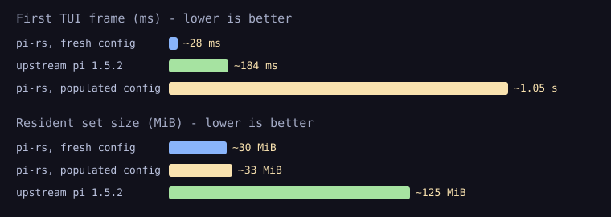

# 🤖 pi-rs

[](https://www.rust-lang.org/)
[](LICENSE)
[](https://github.com/hakergeniusz/pi-rs/releases)
[](https://github.com/hakergeniusz/pi-rs/releases)
[](docs/GAP-STATUS.md)

> A Rust rewrite of [Pi](https://github.com/earendil-works/pi), the minimal,
> extensible agent harness. **Almost 1:1** behavioural and on-disk parity with
> pi 1.5.2, with native Rust extensions on top.

<p align="center"></p>

> **Why pi-rs?** Keep your pi 1.5.2 sessions and extensions, gain native Rust
> plugins, and never touch an existing upstream `~/.pi` install.

---

## ⚡ Install

### Linux & macOS

```sh
curl -fsSL https://hakergeniusz.github.io/pi-rs/install.sh | sh
```

Works in `sh`, `bash` or `zsh`. The one-liner downloads the release asset,
verifies its SHA-256, and installs a `0755` binary to `~/.local/bin/pi-rs` (or
`$PI_INSTALL_DIR`). It never writes outside the prefix and never collides with
an upstream TypeScript `pi` binary.

Prefer reviewing before running? Download the script first:

```sh
curl -fsSLO https://hakergeniusz.github.io/pi-rs/install.sh
sh ./install.sh --help
sh ./install.sh v0.1.1
```

Options: `--prefix DIR`, `--sudo`, `--no-update`, and an optional release `TAG`. Re-running the installer updates an existing install by default.
The repo is public, so no token is required.

### Windows

PowerShell one-liner (per-user, no admin):

```powershell
irm https://hakergeniusz.github.io/pi-rs/install.ps1 | iex
```

It downloads `pi-windows-x86_64.exe`, verifies its SHA-256, and installs
`pi-rs.exe` to `%LOCALAPPDATA%\Programs\pi-rs` by default. Or download the
asset from the [latest release](https://github.com/hakergeniusz/pi-rs/releases/latest)
and put it on your `PATH`.

### npm / Bun

The wrapper source lives in [`npm/`](npm/). It is live on npm as
`@hakergeniusz/pi-rs` (v0.1.2):

```sh
npx @hakergeniusz/pi-rs
bunx @hakergeniusz/pi-rs
npm install -g @hakergeniusz/pi-rs
bun install -g @hakergeniusz/pi-rs
```

It downloads the matching release binary and verifies its SHA-256 during
postinstall. If your npm gates install scripts, the launcher downloads it on
first run instead. Set `PI_RS_SKIP_DOWNLOAD=1` to skip the download during local
development. The upstream `@earendil-works/pi-coding-agent` package is a
different program.

---

## 🪟 Platform support

| Platform       | Asset                   | Notes                       |
| -------------- | ----------------------- | --------------------------- |
| Linux x86-64   | `pi-linux-x86_64`       | primary parity target       |
| Linux aarch64  | `pi-linux-aarch64`      |                             |
| macOS x86-64   | `pi-darwin-x86_64`      | Intel runners               |
| macOS aarch64  | `pi-darwin-aarch64`     | Apple Silicon               |
| Windows x86-64 | `pi-windows-x86_64.exe` | executable asset on release |
| Windows ARM64 | `pi-windows-aarch64.exe` | native ARM64 runner |
| Linux RISC-V 64 | `pi-linux-riscv64` | cross-built with `cross` |
| FreeBSD x86-64 | `pi-freebsd-x86_64` | cross-built with `cross` |
| FreeBSD ARM64 | `pi-freebsd-aarch64` | best effort, tier-3 job (nightly + zig) |
| NetBSD x86-64 | `pi-netbsd-x86_64` | best effort, tier-3 job (nightly + zig) |
| NetBSD ARM64 | `pi-netbsd-aarch64` | best effort, tier-3 job (nightly + zig) |
| OpenBSD x86-64 | `pi-openbsd-x86_64` | best effort, tier-3 job (nightly + zig) |
| OpenBSD ARM64 | `pi-openbsd-aarch64` | best effort, tier-3 job (nightly + zig) |

The first eight are verified by CI; the remaining rows are attempted on each
tag but may not produce an asset when the tier-3 toolchain cannot build the
dependency tree. Failures there never block a release. See
[`docs/PLATFORM-BUILDS.md`](docs/PLATFORM-BUILDS.md) for the exact status and
reasons. `install.sh`, `install.ps1` and the npm wrapper recognise every row.

---

## ✨ Features

- **Almost 1:1 parity** with pi 1.5.2: session JSONL v3, print/JSON/RPC output
  schemas and the project `.pi/` layout stay compatible. Differences are
  mechanism-level and documented in
  [`docs/GAP-STATUS.md`](docs/GAP-STATUS.md).
- **Live-shaped model catalog:** 1,918 entries (1,763 chat, 74 image, 81
  classifier). The 1.5.2 baseline is kept intact and 286 newer models from the
  live pi.dev catalog are added, including `google/gemini-4-hydrogen`. Full
  diff: [`docs/MODEL-CATALOG-DIFF.md`](docs/MODEL-CATALOG-DIFF.md).
- **Four modes:** streaming print (`-p`), JSONL events (`--mode json`), typed
  RPC (`--mode rpc`) and the full interactive TUI (`pi`).
- **Provider coverage:** Anthropic, OpenAI completions and Codex Responses,
  Google GenAI/Vertex, Bedrock Converse, Azure Responses, Mistral Conversations
  and pi-messages, plus built-in OAuth login/refresh for Anthropic, Codex and
  Copilot.
- **Upstream-shaped extensions:** JS/TS extensions run on an embedded QuickJS
  host with upstream dispatch semantics, UI dialogs, renderers, tools,
  shortcuts, context transforms and the RPC dialog subprotocol.
- **Native Rust extensions:** a pi-rs addition that lets compiled plugins
  change almost any part of the host through a stable C ABI.
- **MCP, codemode, images, telemetry, `pi remote`:** client transports and
  host-driven ticks, an inline VM with real local transports, an image pipeline
  with a real pixel backend, opt-in exporters, and remote env/PTY/SSH support.
- **Safe coexistence:** XDG roots mean pi-rs never touches `~/.pi`.

---

## 📊 Performance

Measured on the operator's box against the **real upstream pi 1.5.2**
(`@earendil-works/pi-coding-agent`, Node/bun), not another Rust build. Indicative,
not a benchmark suite.



| Metric | pi-rs (fresh config) | pi-rs (populated config) | upstream pi 1.5.2 |
| --- | ---: | ---: | ---: |
| First TUI frame | **~28 ms** | ~1.05 s | ~184 ms |
| Resident set size | ~30 MiB | ~33 MiB | ~125 MiB |
| Binary | 26 MB, stripped | same | Node runtime |

Startup is config-dependent: with a fresh XDG config pi-rs is roughly **6x
faster** than upstream, while a heavily populated config on this machine makes
it about **5x slower** (model catalog and extension setup dominate). Memory is
consistently around **4x lower** than the Node runtime.

---

## 🚀 Usage

```bash
pi-rs                          # interactive TUI
pi-rs -p "Say hello"           # one-shot print mode
pi-rs --mode json -p "Hi"      # JSONL event stream
pi-rs --mode rpc               # typed request/response over stdio
pi-rs --tui-mode regular       # opt out of fullscreen
pi-rs -e ./my-ext.ts           # load a JS/TS extension
pi-rs remote status            # pi-env remote environment
pi-rs --list-models [search]   # model catalog
```

Inside the TUI: `/` commands, `@file` fuzzy search, `!`/`!!` bash mode,
`ctrl+p` model cycling, steering/follow-up queues, `/model`, `/settings`,
`/resume`, `/compact`, `/trust`, and the `/arminsayshi` easter egg.

---

## 🧩 Config & paths

pi-rs follows the [XDG Base Directory spec](https://specifications.freedesktop.org/basedir-spec/latest/)
under a `pi-rs` leaf:

| Role   | Default                | Contents                                                                           |
| ------ | ---------------------- | ---------------------------------------------------------------------------------- |
| config | `~/.config/pi-rs`      | `settings.json`, `auth.json`, `models.json`, themes, prompts, tools, skills, trust |
| data   | `~/.local/share/pi-rs` | `sessions/`                                                                        |
| cache  | `~/.cache/pi-rs`       | managed binaries (`fd`, `rg`)                                                      |
| state  | `~/.local/state/pi-rs` | debug log                                                                          |

Each root honours its `XDG_*` variable when absolute. `PI_CODING_AGENT_DIR`
collapses every role into one upstream-style directory. Project-local `.pi/`
directories are upstream-compatible.

Extensions: JS/TS files via `-e` or discovery; native plugins via
`PI_NATIVE_EXTENSIONS` or `.pi/native/`.

---

## 🏗️ Build from source

Requires Rust **1.97** (MSRV, pinned by the oxc transpile engine).

```bash
cargo build --release
cargo test
cargo clippy --workspace --all-targets -- -D warnings
cargo fmt --all -- --check
```

`scripts/host-build.sh` is the one-stop gate; the cargo cache lives under
`/var/cache/zstd5` so recompiles stay fast without polluting the repo.
Interactive tests need `fd` and `rg` on `PATH`.

---

## 📚 Documentation

- [`docs/GAP-STATUS.md`](docs/GAP-STATUS.md) - upstream-to-port coverage matrix
- [`HANDOFF.md`](HANDOFF.md) - dated implementation log and gotchas
- [`PLAN.md`](PLAN.md) - phased plan and scope decisions
- [`docs/EXTENSIONS.md`](docs/EXTENSIONS.md) - extension host API and semantics
- [`docs/RELEASE.md`](docs/RELEASE.md) - release runbook

Deferred from core scope: `chord`, `pi-durable`, `evals`, `apps/p2`.
`/share` and `/bug` are omitted by policy (Radius upload).

---

## 🙏 Credits

- [Pi](https://github.com/earendil-works/pi) by Mario Zechner - the upstream
  harness this port follows (MIT), including its logo, sessions and CLI surface.
- The Rust ecosystem crates that make the port possible, notably `rquickjs`,
  `crossterm`, `reqwest` and `oxc`.

---

## 📄 License

MIT - see [LICENSE](LICENSE). Original Pi copyright retained.
